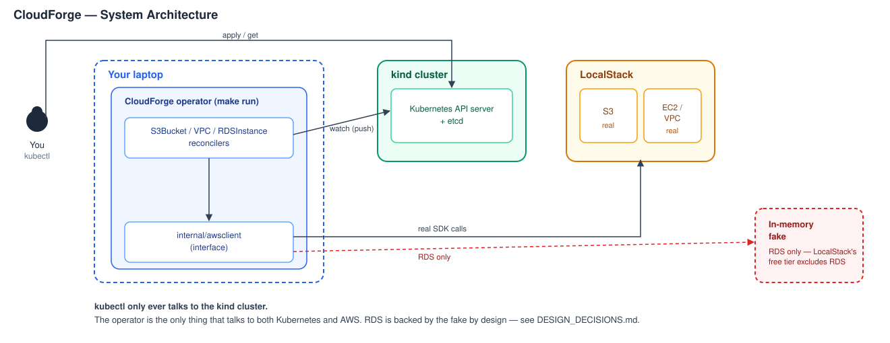

# CloudForge

A Kubernetes operator that manages AWS infrastructure declaratively — define a `VPC`, `S3Bucket`, or `RDSInstance` as a Kubernetes object, and a controller reconciles real cloud state to match. Built with [kubebuilder](https://book.kubebuilder.io/) and [controller-runtime](https://github.com/kubernetes-sigs/controller-runtime), developed and tested entirely for free against [kind](https://kind.sigs.k8s.io/) and [LocalStack](https://www.localstack.cloud/).

> **Status:** all three CRDs are fully implemented — real reconcile logic, finalizer-based cleanup, hermetic tests, and live-demoed proof against real infrastructure. See [`docs/TESTING.md`](docs/TESTING.md) for coverage numbers.



```
kubectl apply  →  Kubernetes API server (kind)  →  controller watches for changes
                                                            │
                                                  Reconcile() reads Spec,
                                                  calls the AWS client,
                                                  writes Status back
                                                            │
                                            internal/awsclient (interface)
                                            ├── real implementation → LocalStack
                                            └── in-memory test double
```

## What it does

Each CRD follows the same control-loop pattern Kubernetes itself uses for Pods and Deployments — a `Spec` describes desired state, a controller reconciles reality to match, a `Status` reports what's actually true — applied to cloud infrastructure instead of containers.

| Resource | What it does |
|---|---|
| **`S3Bucket`** | Provisions an S3 bucket; its finalizer empties the bucket before deleting it. |
| **`VPC`** | Provisions a VPC with a given CIDR block and DNS settings. |
| **`RDSInstance`** | Provisions a database inside a referenced `VPC`, waiting for it to be ready, then hands back credentials as an owner-referenced Kubernetes Secret. |

All AWS access goes through an interface-based client layer, so every controller runs against a real SDK client or an in-memory test double — `S3Bucket`/`VPC` are verified against real LocalStack; `RDSInstance` (which LocalStack only supports on a paid tier) runs against the fake by design. Full diagram and reasoning: [`docs/ARCHITECTURE.md`](docs/ARCHITECTURE.md).

## A few things worth knowing

- Caught a credential-loss bug (RDS's one-time master password) by reasoning through the data lifecycle before writing a single test — full story in [`docs/DESIGN_DECISIONS.md`](docs/DESIGN_DECISIONS.md).
- Designed test coverage around a real limit of the test environment (`envtest` doesn't run Kubernetes's garbage-collector controller) — full story in [`docs/TESTING.md`](docs/TESTING.md).
- All three resources can be applied in one command, in any order — the reconcile loop's wait/requeue logic handles dependency ordering on its own, verified live, not assumed.

## Project Structure

```
api/v1alpha1/                 # CRD type definitions (Spec/Status structs)
├── s3bucket_types.go
├── vpc_types.go
└── rdsinstance_types.go

internal/
├── awsclient/                # AWS access, behind interfaces
│   ├── s3.go, ec2.go, rds.go       # interfaces + real SDK implementations
│   └── fake/                       # in-memory test doubles
└── controller/                # one reconciler per CRD
    ├── s3bucket_controller.go
    ├── vpc_controller.go
    └── rdsinstance_controller.go

cmd/main.go                    # manager entrypoint, wires everything together
config/samples/                # example YAML for each CRD
kind-config.yaml                # local Kubernetes cluster definition
docker-compose.localstack.yaml  # local AWS emulator
```

## Getting Started

### Prerequisites
- Go 1.24+, Docker, [kind](https://kind.sigs.k8s.io/), [kubebuilder](https://book.kubebuilder.io/)
- A free [LocalStack](https://www.localstack.cloud/) account (required even for free-tier services) — set `LOCALSTACK_AUTH_TOKEN` in a local `.env` file

### Run it locally

```sh
kind create cluster --config kind-config.yaml
docker compose -f docker-compose.localstack.yaml up -d
make install   # registers the CRDs with the cluster

AWS_ENDPOINT_URL=http://localhost:4566 \
AWS_ACCESS_KEY_ID=test AWS_SECRET_ACCESS_KEY=test AWS_REGION=us-east-1 \
make run       # starts the operator on the host
```

In another terminal:

```sh
kubectl apply -k config/samples/
kubectl get vpc,s3bucket,rdsinstance -w
```

### Tests

```sh
make test                              # hermetic envtest suite - no LocalStack needed
go test -tags=integration ./...        # round-trips real calls against LocalStack
```

## Documentation

| Doc | Covers |
|---|---|
| [**`docs/ARCHITECTURE.md`**](docs/ARCHITECTURE.md) | How it's built: the reconcile loop, system diagram, command reference. |
| [**`docs/DESIGN_DECISIONS.md`**](docs/DESIGN_DECISIONS.md) | Why it's built this way: scope cuts, trade-offs, the judgment behind the pattern. |
| [**`docs/TESTING.md`**](docs/TESTING.md) | How we know it's correct: testing strategy, bugs caught, real numbers. |
